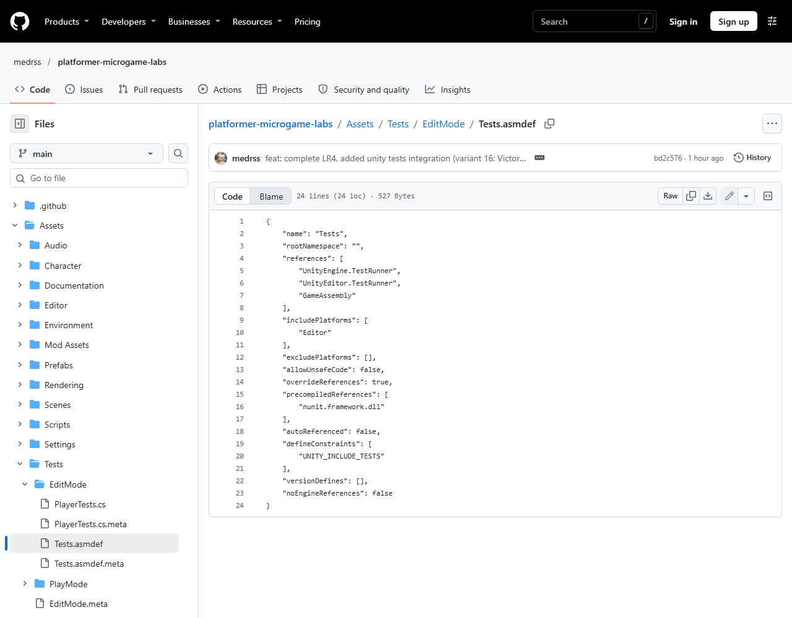
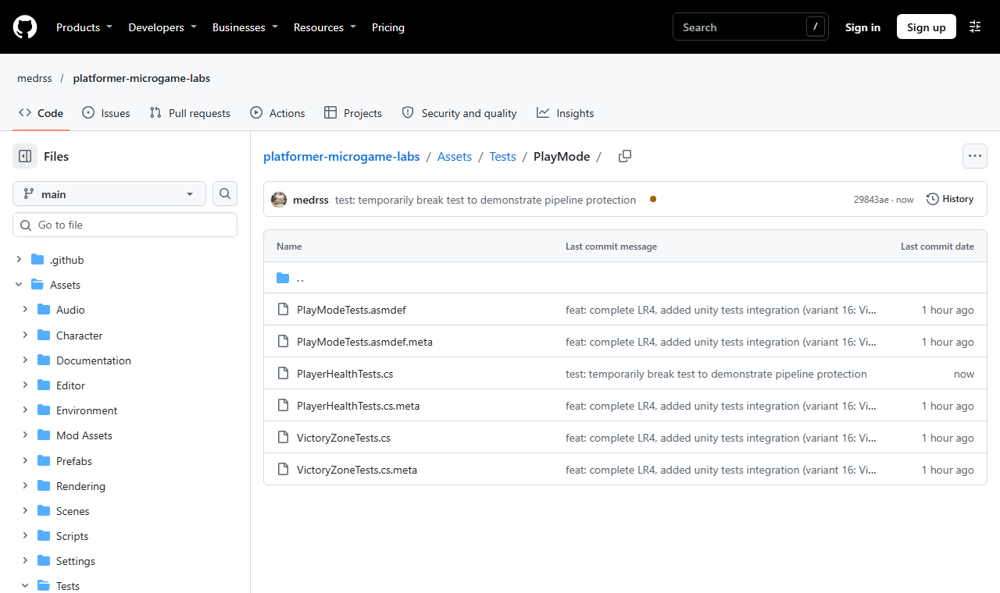
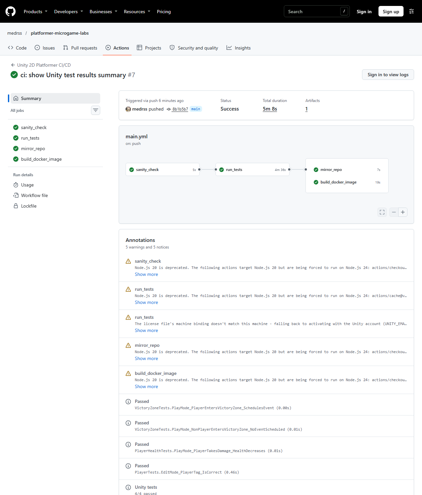
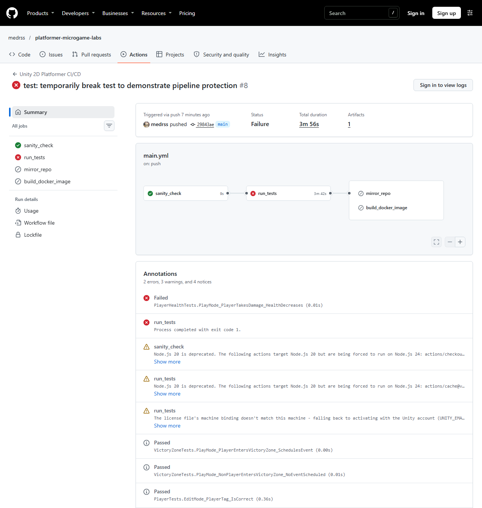

# Лабораторная работа №4: Автоматизация тестирования (Unity Test Runner) в CI/CD

**Студентка:** Карелина Мария Дмитриевна

**Группа:** 23-СТ

**Вариант:** 16 — `PlayerEnteredVictoryZone` (PlayMode): вход игрока в VictoryZone планирует событие

## Цель работы

Настроить автоматический запуск Unity-тестов (EditMode и PlayMode) в облачном пайплайне так, чтобы сборка Docker-образа и зеркалирование выполнялись только при успешном прохождении всех тестов.

## 1. Разделение кодовой базы (Assembly Definitions)

| Файл | Назначение |
|---|---|
| `Assets/Scripts/GameAssembly.asmdef` | Сборка с кодом игры (ссылается на `Unity.InputSystem` и `Unity.Cinemachine`, которые используют скрипты игры) |
| `Assets/Tests/EditMode/Tests.asmdef` | Сборка EditMode-тестов: `includePlatforms: ["Editor"]`, ссылка на `GameAssembly` |
| `Assets/Tests/PlayMode/PlayModeTests.asmdef` | Сборка PlayMode-тестов: без `includePlatforms`, ссылка на `GameAssembly` |

Тестовые сборки подключают NUnit (`nunit.framework.dll`) и `UnityEngine/UnityEditor.TestRunner` и компилируются только при `UNITY_INCLUDE_TESTS`, поэтому не попадают в финальную сборку игры.





## 2. Автоматические тесты

### Базовые тесты (из методички)

* **`EditMode_PlayerTag_IsCorrect`** (`Assets/Tests/EditMode/PlayerTests.cs`) — открывает сцену `SampleScene`, находит объект `Player`, проверяет тег `Player` и наличие компонентов `PlayerController` и `Health`.
* **`PlayMode_PlayerTakesDamage_HealthDecreases`** (`Assets/Tests/PlayMode/PlayerHealthTests.cs`) — создаёт объект с `Health` (`maxHP = 3`), трижды вызывает `Decrement()` и проверяет, что персонаж жив после первого урона и погибает после третьего.

### Тест по варианту 16

Файл: `Assets/Tests/PlayMode/VictoryZoneTests.cs` (PlayMode, сборка `PlayModeTests`).

Проверяемая механика — `VictoryZone.cs` + событие `PlayerEnteredVictoryZone.cs`: когда коллайдер с `PlayerController` входит в триггер `VictoryZone`, в `Simulation` планируется событие `PlayerEnteredVictoryZone`, а при его выполнении игроку включается анимация победы и отключается управление.

**`PlayMode_PlayerEntersVictoryZone_SchedulesEvent`** — сценарий:

1. Создаётся игрок (`PlayerController` + `BoxCollider2D` + `Animator`) и регистрируется в модели `PlatformerModel`.
2. Создаётся зона победы (`BoxCollider2D` с `isTrigger = true` + `VictoryZone`).
3. Вызывается обработчик `OnTriggerEnter2D` зоны с коллайдером игрока.
4. Проверяется, что в очереди событий `Simulation` появилось **ровно одно** событие.
5. После `Simulation.Tick()` проверяется, что событие `PlayerEnteredVictoryZone` выполнилось, ссылается на нашу зону (`ev.victoryZone == zone`), а `player.controlEnabled == false`.

**`PlayMode_NonPlayerEntersVictoryZone_NoEventScheduled`** — дополнительная проверка: объект без `PlayerController` при входе в зону событие **не** планирует.

Особенности реализации:

* объект игрока остаётся неактивным, чтобы `Awake()` `PlayerController` не обращался к Input System — тест проверяет логику зоны, а не управление;
* `OnTriggerEnter2D`, очередь `Simulation.eventQueue` и поле `animator` закрыты (`private`/`internal`), поэтому к ним тест обращается через Reflection;
* перед каждым тестом и после него очередь событий очищается `Simulation.Clear()`.

Результат запуска (Unity Test Runner в контейнере `unityci/editor`, GitHub Actions):

| Тест | Режим | Результат |
|---|---|---|
| `PlayerTests.EditMode_PlayerTag_IsCorrect` | EditMode | ✅ Passed |
| `PlayerHealthTests.PlayMode_PlayerTakesDamage_HealthDecreases` | PlayMode | ✅ Passed |
| `VictoryZoneTests.PlayMode_PlayerEntersVictoryZone_SchedulesEvent` (**вариант 16**) | PlayMode | ✅ Passed |
| `VictoryZoneTests.PlayMode_NonPlayerEntersVictoryZone_NoEventScheduled` (**вариант 16**) | PlayMode | ✅ Passed |

Итог: **4/4 passed**.

## 3. Запуск тестов в GitHub Actions

В `.github/workflows/main.yml` добавлена задача **`run_tests`**:

* запускается после `sanity_check`;
* кэширует папку `Library`;
* устанавливает GameCI CLI `v0.1.72` и запускает тесты в контейнере `unityci/editor` сразу для `playmode` и `editmode` (`COMBINE_RESULTS`);
* версия Unity задана явно: `--engineVersion=6000.5.10f1` (файл `ProjectVersion.txt` исключён `.gitignore`);
* `--coverageEnabled=false` — без инструментирования кода, которое роняет Unity 6 в контейнере (SIGSEGV);
* результаты сохраняются артефактом `test-results` (даже при падении тестов);
* шаг `Test results summary` разбирает XML с результатами и выводит итог по каждому тесту в аннотации и Summary прогона.

Задачи `mirror_repo` и `build_docker_image` теперь зависят от `needs: run_tests`:

```
sanity_check → run_tests → mirror_repo
                         → build_docker_image
```

## 4. Лицензия Unity в секретах репозитория

В `Settings → Secrets and variables → Actions` добавлены секреты:

* `UNITY_LICENSE` — содержимое файла `.ulf` из Unity Hub;
* `UNITY_EMAIL` — email аккаунта Unity;
* `UNITY_PASSWORD` — пароль аккаунта Unity.

Файл лицензии привязан к компьютеру, на котором активирован, поэтому на облачном раннере GameCI активирует редактор через `UNITY_EMAIL`/`UNITY_PASSWORD` (в логе — предупреждение «machine binding doesn't match»). Для аккаунта Unity задан вход по паролю, двухфакторная аутентификация отключена.

## 5. Проверка результатов

* Во вкладке **Actions** задача `run_tests` зелёная, все 4 теста (EditMode и PlayMode) прошли, доступен артефакт `test-results`. После тестов выполнились `mirror_repo` и `build_docker_image`.



* **Демонстрация защиты пайплайна:** в `PlayerHealthTests` временно добавлено `Assert.AreEqual(1, 2)`. Тест `PlayMode_PlayerTakesDamage_HealthDecreases` упал, `run_tests` стал красным, а `mirror_repo` и `build_docker_image` **не запустились** (пропущены). После этого тест возвращён в исправное состояние.



## Ответы на контрольные вопросы

**1. В чём различие между EditMode и PlayMode тестами?**
EditMode-тесты выполняются в редакторе без запуска игрового цикла: проверяют сцены, префабы, настройки, теги — быстро и без симуляции. PlayMode-тесты запускают игру (игровой цикл, физику, `Awake/Start/Update`, корутины через `[UnityTest]` и `yield`) и проверяют поведение объектов во время игры — изменение здоровья, события, движение.

**2. Какую роль играет Assembly Definition (.asmdef)?**
Разделяет код на отдельные сборки. `GameAssembly` выделяет код игры, на который тестовые сборки могут сослаться и «увидеть» его классы. Тестовые сборки при этом изолированы (подключают NUnit и Test Runner и компилируются только при `UNITY_INCLUDE_TESTS`), поэтому тестовые библиотеки не попадают в финальный билд.

**3. Почему `build_docker_image` зависит от `needs: run_tests`?**
Тесты — это гейт качества: если хотя бы один тест упал, задача `run_tests` завершается ошибкой и зависимые задачи не запускаются. Так сломанный коммит не попадает в Docker-образ и в GHCR, а также не зеркалируется в резервный репозиторий.

**4. Как `includePlatforms` влияет на режим запуска тестов?**
Сборка с `"includePlatforms": ["Editor"]` существует только в редакторе, поэтому её тесты запускаются в режиме EditMode. Сборка без этого параметра доступна на всех платформах, и Test Runner запускает её тесты в режиме PlayMode. Поэтому EditMode- и PlayMode-тесты лежат в разных папках с разными `.asmdef`.

## Вывод

Код игры выделен в отдельную сборку `GameAssembly`, написаны EditMode- и PlayMode-тесты, включая тест варианта 16 для события `PlayerEnteredVictoryZone`. Тесты автоматически запускаются в GitHub Actions в контейнере Unity, и при их падении сборка Docker-образа и зеркалирование не выполняются.
