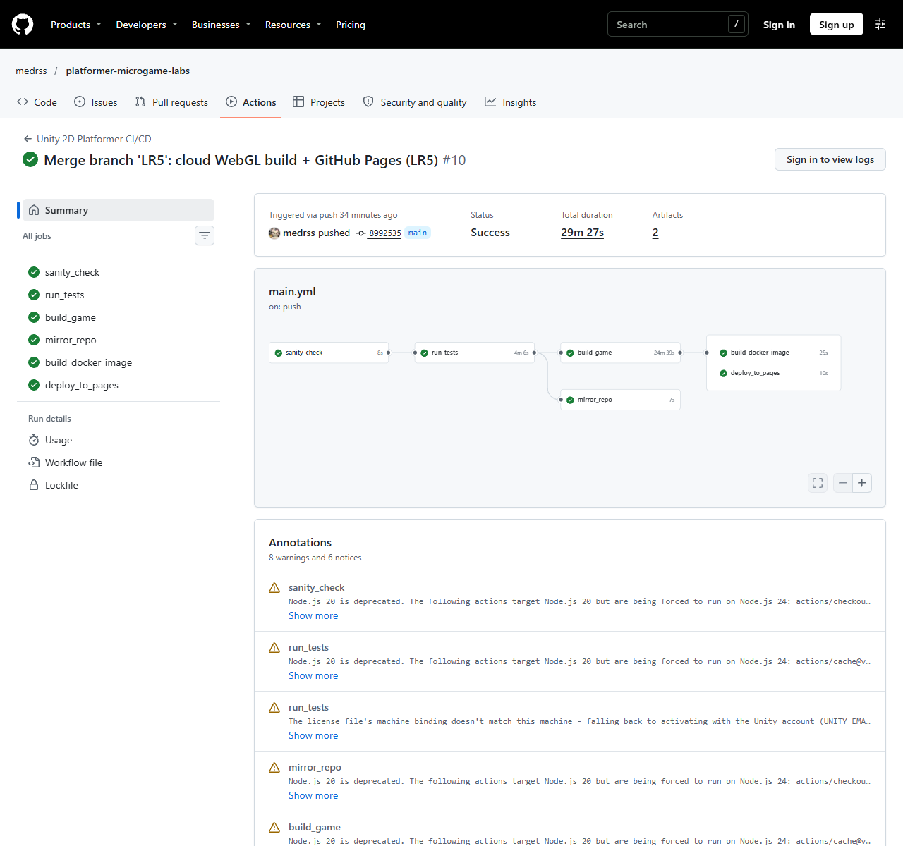
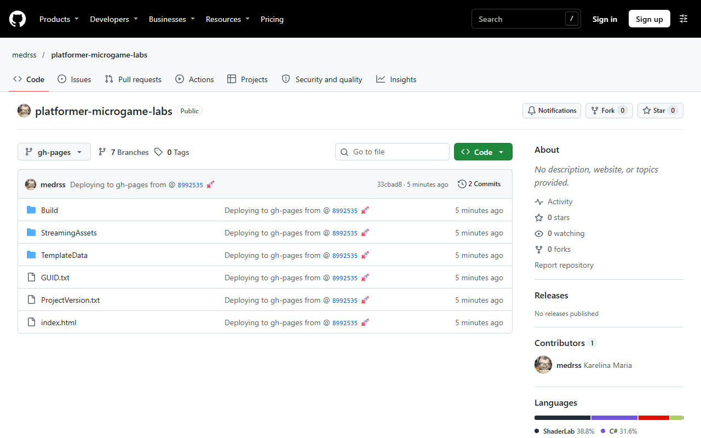
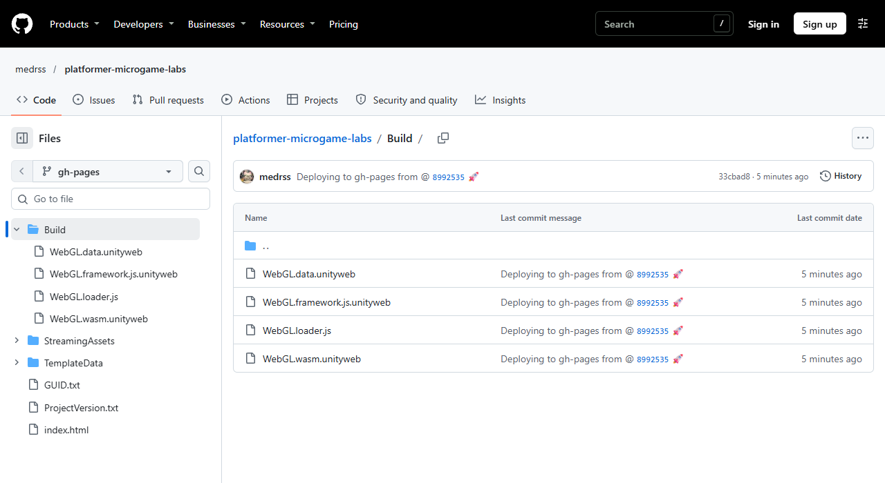
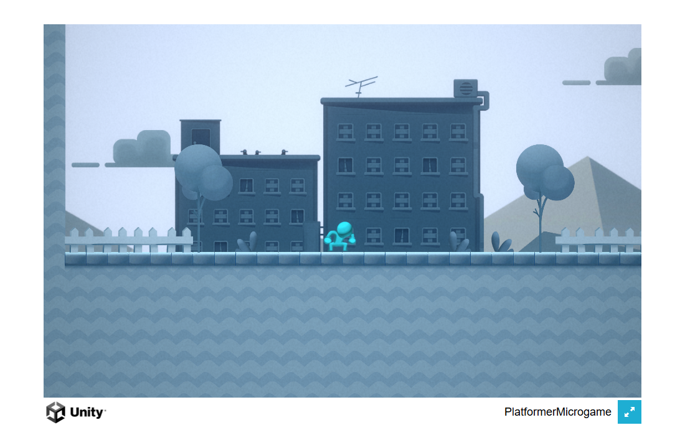

# Лабораторная работа №5: Автоматическая компиляция WebGL-игры в облаке и деплой на GitHub Pages

**Студентка:** Карелина Мария Дмитриевна

**Группа:** 23-СТ

## Цель работы

Настроить сквозной пайплайн, который после успешных тестов компилирует реальный WebGL-билд игры в облаке, публикует его на GitHub Pages и собирает Docker-образ с живой игрой вместо файлов-заглушек.

## 1. Подготовка Unity 6 к деплою на GitHub Pages

В `Player Settings → WebGL → Publishing Settings` формат сжатия оставлен **Gzip**, включена галочка **Decompression Fallback**. GitHub Pages не отправляет заголовок `Content-Encoding: gzip` для предсжатых файлов, поэтому распаковку выполняет встроенный в билд JS-распаковщик Unity.

Проверка значений в `ProjectSettings/ProjectSettings.asset`:

```
$ grep -n "webGLCompressionFormat\|webGLDecompressionFallback" ProjectSettings/ProjectSettings.asset
631:  webGLCompressionFormat: 1
635:  webGLDecompressionFallback: 1
```

> В Unity 6 значения перечисления `WebGLCompressionFormat`: `0 — Brotli`, `1 — Gzip`, `2 — Disabled`, поэтому для Gzip в файле стоит `1`.

## 2. Модернизация пайплайна

В `.github/workflows/main.yml` добавлены задачи:

* **`build_game`** — запускается после `run_tests`. В контейнере `unityci/editor` (экшен `game-ci/unity-builder@v4`) активирует лицензию Unity и вызывает метод **`BuildManager.BuildWebGL`** из ЛР №1 (`unityVersion: 6000.5.10f1`). Папка `Library` кэшируется. Готовая папка `Builds/WebGL` загружается артефактом **`WebGL-Build`**.
* **`build_docker_image`** — теперь зависит от `build_game` и вместо заглушек (`touch`) скачивает артефакт `WebGL-Build` в `Builds/WebGL`, собирая образ Nginx с настоящей игрой.
* **`deploy_to_pages`** — скачивает артефакт `WebGL-Build` и публикует его в служебную ветку **`gh-pages`** экшеном `JamesIves/github-pages-deploy-action@v4`.

Итоговая цепочка задач:

```
sanity_check → run_tests → build_game → build_docker_image (ghcr.io/medrss/platformer-game)
                         │            → deploy_to_pages   (ветка gh-pages → GitHub Pages)
                         → mirror_repo
```

## 3. Отправка и запуск в облаке

Изменения выполнены в ветке `LR5` и объединены с `main`:

```
git commit -m "feat: complete LR5, integrated real cloud unity build and pages deploy"
git push origin main
```

## 4. Результат облачного прогона

Первый полный прогон занял **29 минут** (из них `build_game` — 24,5 минуты: скачивание образа Unity 6 и первичный импорт ассетов). Все шесть задач зелёные, `build_game` запустился только после успешных `run_tests` (4/4 теста).



В аннотации `build_game` выводится состав настоящего билда (**23 МБ**):

```
WebGL build (23M): WebGL.data.unityweb  WebGL.framework.js.unityweb  WebGL.loader.js  WebGL.wasm.unityweb
```

> При включённом Decompression Fallback Unity сохраняет сжатые Gzip файлы с расширением `.unityweb` вместо `.gz` — распаковщик внутри `WebGL.loader.js` сам определяет формат и распаковывает их в браузере.

## 5. Ветка gh-pages

Задача `deploy_to_pages` выгрузила в ветку `gh-pages` файл `index.html` и папки `Build`, `StreamingAssets`, `TemplateData`:





GitHub Pages включён один раз вручную: `Settings → Pages → Source: Deploy from a branch → gh-pages, / (root)`. После этого игра доступна по адресу **https://medrss.github.io/platformer-microgame-labs/** — загрузка проходит без ошибок распаковки (работает Decompression Fallback):


## 6. Docker-образ с настоящей игрой

Образ `ghcr.io/medrss/platformer-game:latest` теперь содержит реальный билд вместо заглушек:

```
$ docker run -d -p 8089:80 --name lr5_game ghcr.io/medrss/platformer-game:latest
$ docker exec lr5_game ls -la /usr/share/nginx/html/Build
-rw-r--r--  8787145  WebGL.data.unityweb
-rw-r--r--    87292  WebGL.framework.js.unityweb
-rw-r--r--    47867  WebGL.loader.js
-rw-r--r-- 14374451  WebGL.wasm.unityweb
```

Игра, запущенная из образа по адресу `http://localhost:8089`:



## Ответы на контрольные вопросы

**1. Почему папка `Builds/WebGL` закрыта `.gitignore` и как файлы попадают в `build_docker_image` и `deploy_to_pages`?**
Билд — это результат компиляции (десятки мегабайт бинарных файлов), который заново создаётся из исходников при каждой сборке; хранить его в Git бессмысленно и раздувает историю. Задача `build_game` загружает папку артефактом `WebGL-Build` (`upload-artifact`), а `build_docker_image` и `deploy_to_pages` скачивают его (`download-artifact`) в `Builds/WebGL`.

**2. Зачем `build_game` указывать `needs: run_tests` и что будет, если тесты упадут?**
Чтобы компилировать и публиковать только проверенный код. Если тесты упадут, `build_game` не запустится, а вместе с ним пропускаются зависящие от него `build_docker_image` и `deploy_to_pages` — сломанная версия не попадёт ни в GHCR, ни на сайт.

**3. Какую роль выполняет `BuildManager.BuildWebGL` и почему результат виден пайплайну?**
Это C#-метод из ЛР №1, который берёт сцены из Build Settings, вызывает `BuildPipeline.BuildPlayer` для WebGL в папку `Builds/WebGL` и пишет в лог итог сборки. В batch-режиме он завершает редактор через `EditorApplication.Exit(0/1)`, поэтому код возврата передаётся контейнеру, и при ошибке компиляции шаг пайплайна становится красным.

**4. Почему GitHub Pages требует Decompression Fallback, а Docker-образ с Nginx обходится без неё?**
GitHub Pages — статический хостинг без настройки заголовков: он не отправляет `Content-Encoding: gzip`, и браузер не распаковывает файлы сам. Decompression Fallback встраивает в билд JS-распаковщик. В нашем Nginx заголовки настраиваются в `nginx.conf` (ЛР №3), и распаковку выполняет сам браузер.

**5. Чем отличается доставка через GitHub Pages и через Docker-образ в GHCR, и зачем нужны теги `latest` и `github.sha`?**
GitHub Pages — бесплатный публичный хостинг статических файлов «для проверки», привязанный к репозиторию. Docker-образ — переносимый артефакт (веб-сервер + игра), который запускается одной командой на любом сервере с Docker. `latest` указывает на последнюю сборку, `github.sha` неизменяемо привязывает образ к коммиту и позволяет откатиться на конкретную версию.

**6. Почему при успешной `deploy_to_pages` сайт может отдавать 404 и как это исправить?**
Задача только выкладывает файлы в ветку `gh-pages`, но не включает хостинг. Нужно один раз включить Pages: `Settings → Pages → Source: Deploy from a branch → Branch: gh-pages, / (root) → Save`. После этого каждый новый билд обновляет сайт автоматически.

## Вывод

Пайплайн стал сквозным: после успешных тестов игра компилируется в облаке методом из ЛР №1, настоящий билд передаётся между задачами через артефакты, упаковывается в Docker-образ с Nginx и публикуется на GitHub Pages.
