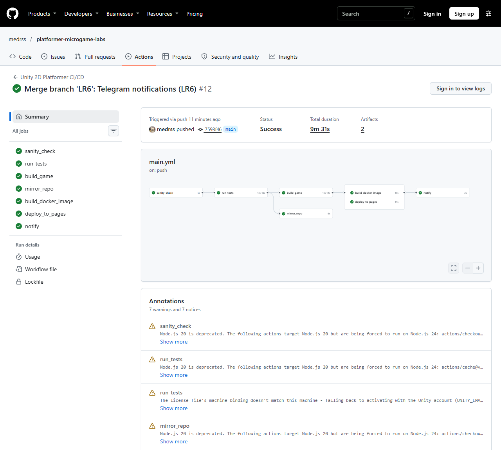
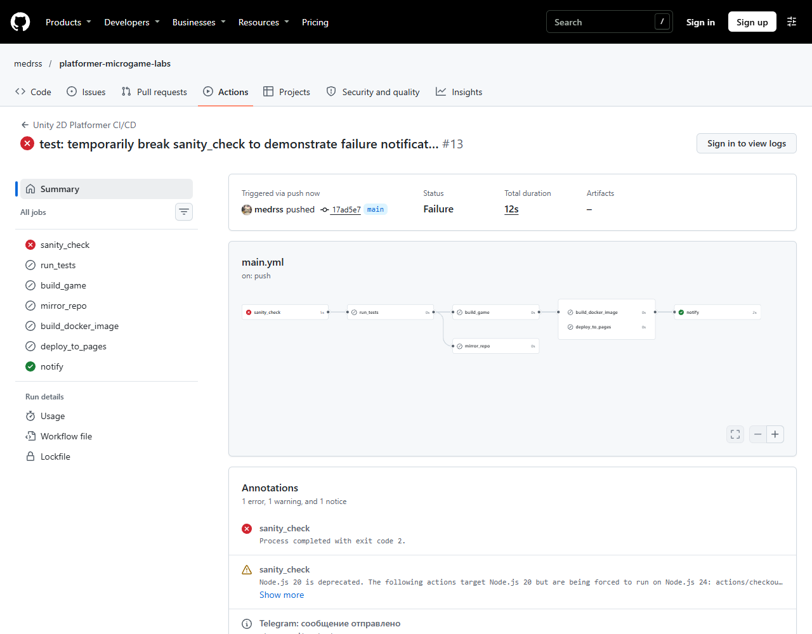

# Лабораторная работа №6: Мониторинг пайплайна, Webhooks и Telegram-оповещения

**Студентка:** Карелина Мария Дмитриевна

**Группа:** 23-СТ

## Цель работы

Настроить обратную связь от облачного сервера к команде разработки: после каждого прогона пайплайна Telegram-бот присылает сообщение с результатом — успехом или именем упавшей задачи.

## 1. Создание Telegram-бота

1. В Telegram у официального бота **@BotFather** выполнена команда `/newbot`, заданы имя и username бота (оканчивается на `bot`), получен токен вида `123456789:AAH…`.
2. В личном чате с ботом отправлена команда `/start` — без неё бот не может написать первым.
3. Идентификатор чата получен запросом:

```
curl -s "https://api.telegram.org/bot<TOKEN>/getUpdates"
```

В ответе в массиве `result` найдено поле `chat.id` — это `CHAT_ID` личного чата с ботом.

## 2. Секреты репозитория

В `Settings → Secrets and variables → Actions` созданы секреты:

* `TELEGRAM_BOT_TOKEN` — токен бота;
* `TELEGRAM_CHAT_ID` — идентификатор чата.

Токен и `chat_id` не встречаются ни в `main.yml`, ни в других файлах проекта; в логах прогона GitHub маскирует их звёздочками.

## 3. Задача `notify` в пайплайне

В `.github/workflows/main.yml` добавлена задача **`notify`**:

* `needs: [sanity_check, run_tests, build_game, build_docker_image, deploy_to_pages]` — ждёт все задачи пайплайна;
* `if: always()` — запускается при любом исходе (аналог `after_script` / `on_failure`);
* шаг `Determine pipeline status` по `needs.<задача>.result` находит первую неуспешную задачу (`stage`) или `none`, если всё прошло;
* шаг `Send Telegram notification` формирует текст и отправляет POST-запрос в метод `sendMessage` Telegram Bot API:
  * при успехе — автор коммита, ссылка на игру на GitHub Pages и ссылка на прогон;
  * при падении — имя упавшей задачи, автор коммита и ссылка на лог прогона;
* JSON собирается через `jq` (корректное экранирование переносов строк и кавычек), ответ API проверяется: при `"ok": false` задача становится красной и выводит описание ошибки.

```
sanity_check → run_tests → build_game → build_docker_image ─┐
                         │            → deploy_to_pages   ──┼→ notify (if: always())
                         → mirror_repo                      │
                  (все задачи) ─────────────────────────────┘
```

## 4. Проверка обоих сценариев

### Успешный сценарий

После пуша изменений все задачи пайплайна завершились успешно, задача `notify` отправила сообщение (`stage=none`) со ссылкой на игру, именем автора коммита и ссылкой на прогон.



Сообщение в Telegram:

<!-- Скриншот: сообщение «✅ Сборка ... завершена успешно» в Telegram -->

### Аварийный сценарий

В шаг `Check Unity Directories` временно добавлена заведомо ошибочная команда `ls NonExistentFolder`. Задача `sanity_check` упала, все остальные задачи пропущены, а `notify` (благодаря `if: always()`) **осталась зелёной** и отправила сообщение с именем упавшей задачи (`stage=sanity_check`), автором коммита и ссылкой на лог.



Сообщение в Telegram:

<!-- Скриншот: сообщение «❌ Сборка ... упала на задаче sanity_check» в Telegram -->

После проверки ошибочная команда удалена, `main.yml` возвращён в рабочее состояние.

## Ответы на контрольные вопросы

**1. Чем webhook отличается от polling API и какую задачу он решает в CI/CD?**
При polling клиент сам периодически спрашивает сервер о статусе («сборка готова?»), тратя запросы и узнавая о событии с задержкой. Webhook — push-механизм: система сама отправляет HTTP-запрос на заданный URL в момент события. В CI/CD это позволяет команде мгновенно узнавать о результате сборки, не открывая вкладку Actions.

**2. Почему токен бота и `chat_id` нельзя хранить в `main.yml` или в коде?**
Это учётные данные: файл `main.yml` попадает в репозиторий (а у нас он публичный) и в историю коммитов. Любой, кто увидит токен, сможет читать переписку бота и писать от его имени. Секреты GitHub недоступны в исходном коде и маскируются в логах; при утечке токен нужно отозвать командой `/revoke` у @BotFather.

**3. Какую роль играют `needs` и `if: always()` в задаче `notify`? Что будет без `if: always()`?**
`needs` перечисляет все задачи, чтобы `notify` запускалась последней и могла прочитать их статусы через `needs.<задача>.result`. `if: always()` запускает её даже при падении зависимостей. Без него при любой ошибке `notify` была бы пропущена (skipped) — сообщения приходили бы только об успешных сборках, то есть как раз тогда, когда они менее всего нужны.

**4. Какие поля JSON передаёт `sendMessage` и как curl отправляет такой POST-запрос?**
Обязательные поля — `chat_id` (кому) и `text` (текст сообщения). curl отправляет запрос командой `curl -s -X POST "https://api.telegram.org/bot<TOKEN>/sendMessage" -H "Content-Type: application/json" -d '{"chat_id":"…","text":"…"}'`: `-X POST` задаёт метод, `-H` — заголовок с типом содержимого, `-d` — тело запроса с JSON.

## Вывод

Пайплайн получил обратную связь: задача `notify` с `if: always()` после каждого прогона отправляет в Telegram сообщение о результате. Токен и идентификатор чата хранятся в секретах репозитория. Проверены оба сценария — успешная сборка и специально сломанная.
